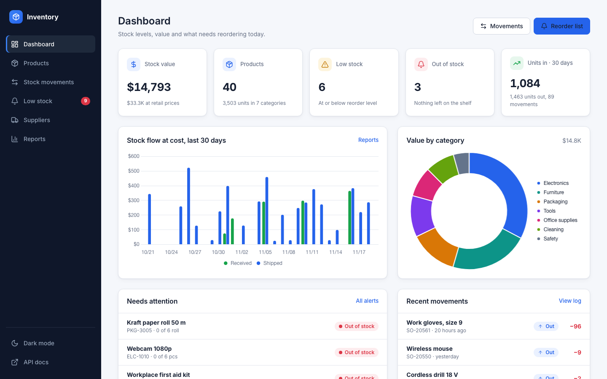
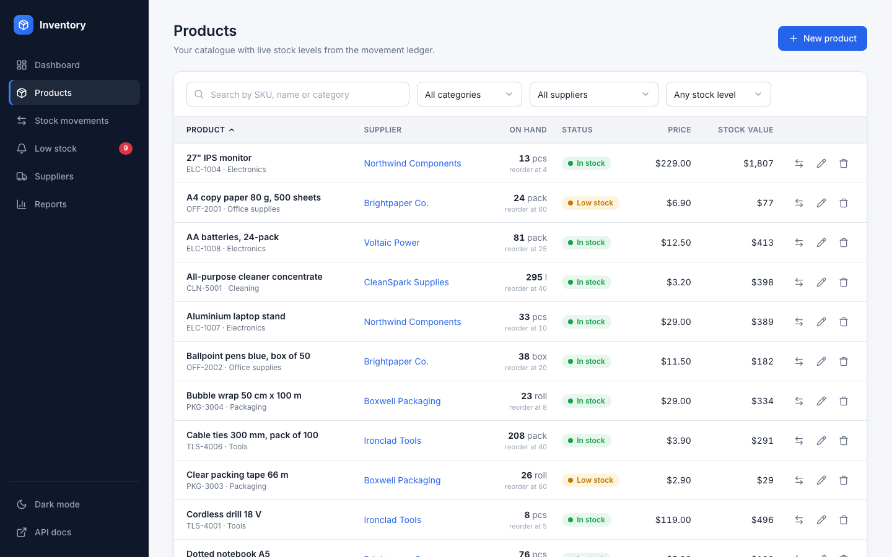
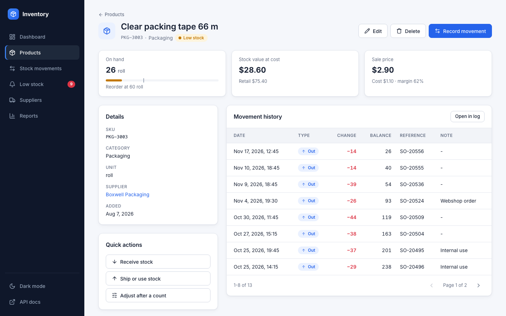
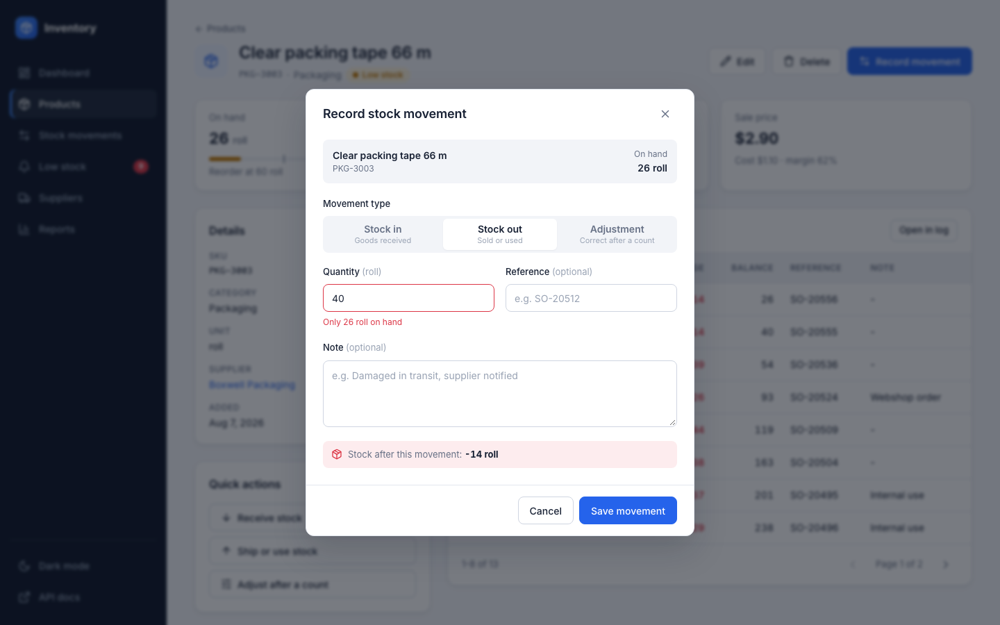
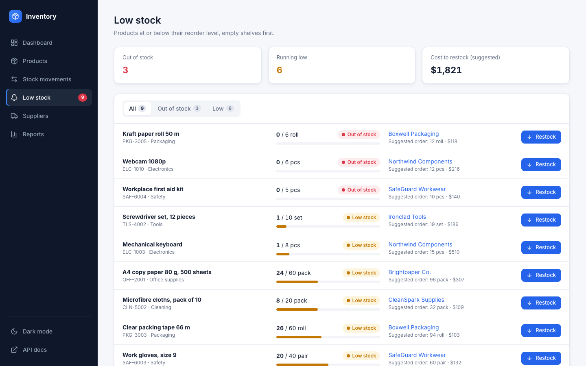
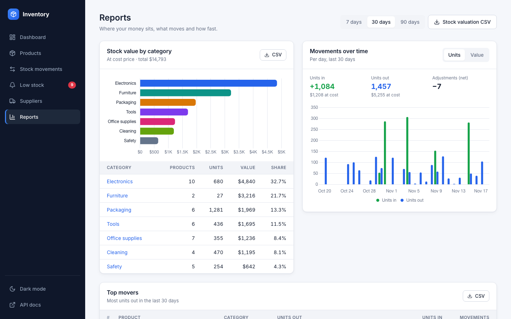

# Inventory Manager

Stock control for small shops and warehouses: products, a stock movement ledger, low-stock alerts, suppliers and reports, built with Angular 21 and FastAPI.

**Live demo (runs on sample data in the browser): https://hkhodkar.github.io/inventory-manager/**



| Products | Product with movement history |
| --- | --- |
|  |  |

## Features

- **Products** - SKU, name, category, unit, cost and sale price, reorder level and supplier. Search, filter by category, supplier or stock status, sort and page on the server, with the filters kept in the URL
- **Stock ledger** - stock is never typed in by hand. Every change is a movement (stock in, stock out or an adjustment after a count) with a reference and a note, and the current stock is the sum of the ledger. Each movement stores the balance after it
- **No negative stock** - the form checks the quantity against what is on hand while you type, and the API refuses anything that would go below zero with a clear `409` message
- **Movement log** - every movement across the catalogue with search, type and date filters, quick 7 / 30 / 90 day ranges and CSV export
- **Low-stock alerts** - products at or below their reorder level, empty shelves first, with a suggested order quantity and cost and a one-click restock. The count is shown as a badge in the navigation
- **Suppliers** - contact details, lead time, notes and the products they supply, with stock value per supplier
- **Reports** - stock value by category, units or value moved over time, top movers for the period and CSV exports (stock valuation, categories, top movers)
- **Dashboard** - KPI cards, stock flow chart, value by category, products that need attention and recent movements
- **Demo data** - 40 products, 8 suppliers and about 200 movements over the last 90 days, loaded when the database is empty
- **Dark mode** and a responsive layout that works down to phone width

| Recording a movement | Low-stock alerts |
| --- | --- |
|  |  |



## Tech Stack

**Frontend**

- [Angular 21](https://angular.dev) - standalone components, signals, `computed` / `linkedSignal`, `rxResource`, new control flow, zoneless change detection, OnPush everywhere
- Typed reactive forms, lazy-loaded routes, router input binding for route and query params
- [Chart.js](https://www.chartjs.org/) through a small directive, colors taken from the theme
- Custom SCSS with CSS variables for light and dark themes
- [Vitest](https://vitest.dev/) for unit tests

**Backend**

- [FastAPI](https://fastapi.tiangolo.com/) with Pydantic v2
- SQLAlchemy 2 with SQLite, stock computed from the movement table with a SQL subquery
- pytest with an in-memory database

**Tooling**

- Docker Compose (nginx serves the Angular build and proxies `/api` to FastAPI)
- GitHub Actions running backend and frontend tests on every push, and deploying the demo build to GitHub Pages

## Getting Started

### With Docker

```bash
git clone https://github.com/hkhodkar/inventory-manager.git
cd inventory-manager
docker compose up --build
```

- App: http://localhost:8080
- API docs: http://localhost:8000/docs

Data is kept in a Docker volume. Run `docker compose down -v` to start over with fresh demo data.

### Local development

Requirements: Python 3.12+, Node.js 20.19+ or 22.12+.

Backend:

```bash
cd backend
python -m venv .venv
source .venv/bin/activate        # Windows: .venv\Scripts\activate
pip install -r requirements-dev.txt
uvicorn app.main:app --reload
```

The API runs on http://localhost:8000 and creates `inventory.db` with demo data on first start.

Frontend (in a second terminal):

```bash
cd frontend
npm install
npm start
```

Open http://localhost:4200. The dev server proxies `/api` to the backend (see `proxy.conf.json`).

### Demo mode

The frontend can also run without the backend. In demo mode every `/api` call is answered by a mock API inside the app (`frontend/src/app/core/mock`): an HTTP interceptor backed by an in-memory database. It follows the same rules as FastAPI (search, filters, sorting, paging, the stock ledger, reports, validation errors and 404s), and changes are kept in `localStorage`, so they survive a reload. A banner shows when demo mode is on and has a **Reset data** button.

- `npx ng build --configuration demo` always uses the mock. This is the build deployed to GitHub Pages by `.github/workflows/deploy.yml`.
- A normal build talks to the real API. If no API answers (the server is down, or a static host returns its own 404 page), the app switches to demo mode for the rest of the session.

Both sides start from the same file, `backend/app/seed_data.json`. `backend/tests/parity_cases.json` lists requests with their expected results; the pytest suite checks them against the API and the Vitest suite against the mock, so the two can't drift apart.

To try the demo build locally: `npx ng serve --configuration demo`.

### Tests

```bash
cd backend && pytest                       # API tests
cd frontend && npm test -- --watch=false   # unit tests
```

### Configuration

The backend reads a few environment variables:

| Variable | Default | |
| --- | --- | --- |
| `DATABASE_URL` | `sqlite:///./inventory.db` | SQLAlchemy database URL |
| `SEED_DEMO_DATA` | `true` | load demo data when the database is empty |
| `CORS_ORIGINS` | `http://localhost:4200` | comma separated list of allowed origins |

## API

Interactive docs (Swagger UI) are at **http://localhost:8000/docs**. The main endpoints:

| Method | Path | |
| --- | --- | --- |
| `GET` | `/api/products` | list with `search`, `category`, `supplier_id`, `stock_status` (`in_stock`, `low`, `out`), `sort`, `page`, `page_size` |
| `GET` | `/api/products/categories` | category names for filters |
| `GET` | `/api/products/{id}/movements` | movement history of one product, newest first |
| `POST` | `/api/products/{id}/movements` | record stock in, out or an adjustment (`409` if stock would go negative) |
| `GET` | `/api/movements` | movement log with `search`, `type`, `product_id`, `date_from`, `date_to`, `sort`, paging |
| `GET` | `/api/suppliers` | list with `search`, `sort`, paging, product count and stock value |
| `GET` | `/api/alerts/low-stock` | products at or below their reorder level |
| `GET` | `/api/reports/dashboard` | KPIs and recent movements |
| `GET` | `/api/reports/stock-by-category` | stock value at cost and retail per category |
| `GET` | `/api/reports/top-movers` | most units out in the last `days` |
| `GET` | `/api/reports/movements-over-time` | units and value in and out per day |

Products and suppliers also have `POST`, `GET /{id}`, `PATCH /{id}` and `DELETE /{id}`. Sorting takes a field name, prefixed with `-` for descending (for example `?sort=-stock_value`).

## Project Structure

```
backend/
├── app/
│   ├── main.py            # app factory, CORS, router setup, seeding on startup
│   ├── models.py          # Supplier, Product, StockMovement (SQLAlchemy)
│   ├── schemas.py         # Pydantic request and response models
│   ├── seed.py            # loads seed_data.json into an empty database
│   └── routers/           # products, movements, suppliers, alerts and reports
├── tests/                 # pytest suite and the shared parity cases
└── Dockerfile
frontend/
├── src/app/
│   ├── core/              # API services, models, helpers and the mock API for demo mode
│   ├── features/
│   │   ├── dashboard/     # KPI cards, charts, needs attention, recent movements
│   │   ├── products/      # list, detail page and product form
│   │   ├── movements/     # movement log and the stock movement form
│   │   ├── alerts/        # low-stock list with restock
│   │   ├── suppliers/     # list, detail page and form
│   │   └── reports/       # charts, top movers and CSV exports
│   └── shared/            # modal, toasts, badges, pagination, chart directive, pipes
├── nginx.conf
└── Dockerfile
docker-compose.yml
```

## Author

**Hatef Khodkar** - [github.com/hkhodkar](https://github.com/hkhodkar)

## License

[MIT](LICENSE)
